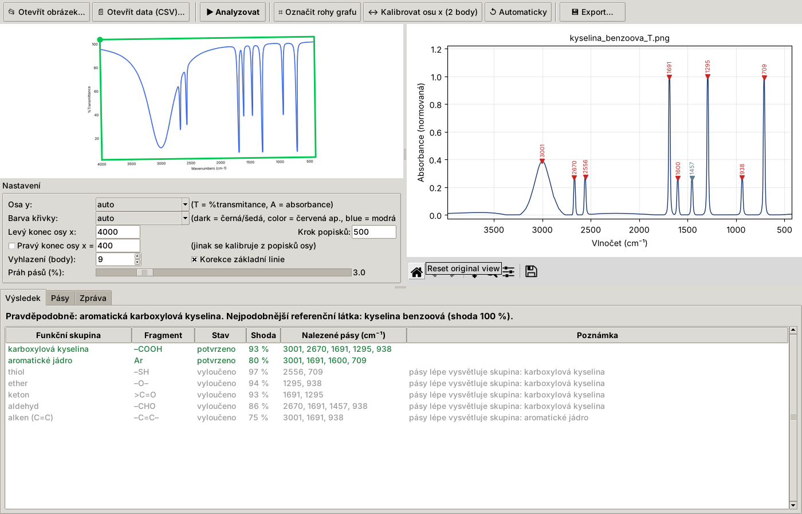

# IR Spectrum Analyzer

Desktop app (Python + Tkinter). You give it a **picture of an infrared spectrum**: a photo of
an OMNIC printout, a scan or a screenshot. The app digitises the curve, finds the absorption
bands and lists the **functional groups** the compound contains. It also suggests a
compound class and the closest match from a small library of reference compounds.

The interpretation follows *Tabulka I – Vlnočty charakteristických vibrací vybraných
funkčních skupin* from the VŠCHT LACH I guide *Infračervená spektroskopie*. A group counts as
confirmed only when its key bands are present. A key band is the first characteristic band
plus its "další charakteristický pás" chain. The app also uses the guide's rules of thumb:

- C–H above or below 3000 cm⁻¹ (unsaturated vs. saturated)
- the C=O region
- the δs(CH3) singlet or doublet (branching)
- the γ(CH) pattern (aromatic substitution)
- the acetate band

The user interface is in Czech.



## Installation

```bash
pip install -r requirements.txt
```

Tkinter must be available. On Debian/Ubuntu install it with `sudo apt install python3-tk`;
on Windows and macOS it ships with the python.org installer.

## Usage

### GUI

```bash
python app.py                 # or: python app.py fotka_spektra.jpg
```

1. **Otevřít obrázek…** opens a photo, scan or screenshot of the spectrum. **Otevřít data
   (CSV)…** opens a two-column file of wavenumber and intensity.
2. The plot area is detected automatically and shown as a green frame. The traced curve is
   drawn in blue over the image.
3. **Analyzovat** shows the spectrum in normalised absorbance. Detected bands are marked:
   red for assigned bands, grey for unassigned ones.
4. The result tabs:
   - **Výsledek**: summary, plus the confirmed, possible and excluded groups with the bands
     that support each one.
   - **Pásy**: every band with its intensity (s/m/w, br) and assignment. Clicking a band
     highlights it in the plot.
   - **Zpráva**: a text report you can copy into a lab protocol.
5. **Export…** saves the band table (CSV), the digitised spectrum (CSV), the report (TXT) and
   the plot (PNG).

When the automatic steps fail:

| Problem | Fix |
|---|---|
| Wrong frame | **Označit rohy grafu**, then click the 4 corners of the plot area |
| Wrong x axis | **Kalibrovat osu x (2 body)**, then click two labelled ticks and type their wavenumbers. You can also set *Levý konec osy x* and *Krok popisků*, or tick *Pravý konec osy x* |
| Wrong y axis | set *Osa y* to `T` (%transmittance) or `A` (absorbance) |
| Curve not found | set *Barva křivky* (`dark`, `color` = red/green…, `blue`) |
| Too many or too few bands | move the *Práh pásů* slider |

### Command line

```bash
python analyze.py spektrum.jpg
```

```bash
python analyze.py spektrum.csv --mode T
```

### Examples

`examples/` holds synthetic example images (polystyrene, ethyl acetate, benzoic acid,
benzaldehyde). To regenerate them:

```bash
python examples/make_examples.py
```

## How it works

```
image ─► plot-area detection ─► perspective rectification ─► curve extraction ─► x calibration
      ─► resampling (1 cm⁻¹) ─► %T → absorbance ─► Savitzky–Golay smoothing ─► ALS baseline
      ─► peak detection (prominence, FWHM) ─► band ↔ Table I matching ─► groups + report
```

| Module | Purpose |
|---|---|
| `spectra/digitize.py` | Finds the axes: long lines from a Hough transform, the L-shaped corner with tick marks, and the top/right frame. Corrects perspective with a homography. Removes frame lines, labels and blue handwritten notes, then traces the curve column by column with continuity tracking. Calibrates the x axis automatically from the centres of the tick labels (4000, 3500, …). |
| `spectra/signal.py` | Resampling, %T → A conversion, Savitzky–Golay smoothing, asymmetric least-squares baseline, `scipy.signal.find_peaks`. Classifies intensity (s/m/w) and flags broad bands. Marks the CO₂ artefact at 2360/2335 cm⁻¹. |
| `spectra/ir_table.py` | Table I as data: bands, key bands, intensities, broad/sharp flags, exclusion rules. |
| `spectra/interpret.py` | Scores groups against the detected bands and applies the confirm/possible/exclude logic. Adds the special rules (CH3 doublet, aromatic substitution, acetate, alcohol type…), writes the summary and report, and matches against the reference library. |
| `spectra/references.py` | Approximate band lists of about 50 common compounds (orientation only). |
| `spectra/pipeline.py` | Joins the steps together (used by the GUI and the CLI). |

## Tests

```bash
python -m pytest
```

The tests build synthetic spectra from Lorentzian bands, render them as images with
matplotlib (%T and A, black, coloured and slightly rotated), then digitise and interpret
them. They check band positions to within ±10 cm⁻¹ and the expected functional groups.

## Limitations

- The digitised spectrum is only as accurate as the picture. Expect a few cm⁻¹ of error
  (about 5–10 cm⁻¹ on phone photos), and band intensities are approximate.
- The app identifies functional groups and the compound class. Naming the exact molecule
  needs a comparison with a spectral library; the built-in reference list only gives a
  hint.
- Weak shoulders on the slope of a strong band, such as 721 cm⁻¹ next to a steep edge, may
  be missed. Lower the band threshold to catch them.
- Inorganic anions (carbonate, sulfate, nitrate, phosphate/silicate) are covered only
  roughly. Table I does not include them.
